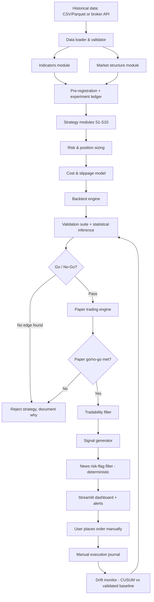

# Architecture.md

**Educational material only. Nothing here is investment advice or a promise of profit.**

This replaces the earlier Kafka/Flink/Redis/3-laptop/LLM-multi-agent architecture discussed previously. That design was built for a latency and decision-making profile this project does not have. Everything below runs on a single machine.

---

## 1. App flow (end to end)



Three stages, same core engine code reused throughout:
1. **Research** — backtest on historical data only.
2. **Paper** — same engine, live/replayed data, simulated broker, frozen rules.
3. **Manual** — same engine, produces signals only; a human places every order.

No stage places a real order automatically. Stage 3's output is a trade plan, not an instruction to a broker API.

---

## 2. Folder & file structure

```
project-root/
├── config/
│   ├── default.yaml          # all tunable parameters, never hardcoded
│   └── costs.yaml             # Indian cost/slippage rates, filled from real broker charge sheet
├── data/
│   ├── loaders/                # CSV/Parquet/broker API loaders
│   └── validators/             # OHLC sanity, calendar, duplicate/missing bar checks
├── indicators/                 # SMA, EMA, RSI, ATR, ADX, VWAP, Bollinger, ER — vectorised, unit-tested
├── structure/                  # swings, BOS, CHoCH/MSS, liquidity, premium/discount
├── patterns/                   # candlestick pattern library (confirmation only)
├── strategies/
│   ├── s1_ema_pullback.py
│   ├── s2_ema_crossover.py
│   ├── s3_sma_filter.py
│   ├── s4_rsi.py
│   ├── s5_fibonacci.py
│   ├── s6_order_block.py
│   ├── s7_fvg.py
│   ├── s8_ict_model.py
│   ├── s9_orb.py
│   └── s10_chart_patterns.py
├── risk/                       # position sizing, open-risk limits, kill-switch
├── costs/                      # Indian brokerage/STT/GST/stamp-duty cost model
├── engine/                     # event-driven backtest/paper engine (one code path, reused)
├── validation/                 # walk-forward, benchmarks, ablation, Monte Carlo, reports
├── stats/                      # inference: CIs/bootstrap, Sharpe/PSR/DSR, multiple testing, PBO
├── execution/                  # order_plan: sizing net of costs, e_max/e_min, fill probability, implementation shortfall
├── monitoring/                 # CUSUM live-drift detection, slippage-vs-model tracking
├── experiments/                # experiment ledger (SQLite) — every backtest run logged automatically
├── regime/                     # rule-based regime classifier (ADX/ER) + strategy permissions
├── paper/                      # automated paper-trading loop, state persistence
├── signals/                    # signal object, alerts, manual execution journal
├── dashboard/                  # Streamlit app
├── tests/                      # pytest suite, mirrors every module above, incl. canary tests (§10 of Quant_Math_Spec.md)
├── reports/                    # generated validation/verdict reports, equity curves
└── docs/
    └── spec/                   # PRD.md, Architecture.md, Rules.md, Phases.md, Design.md, Quant_Math_Spec.md
```

---

## 3. Tech stack

| Layer | Choice | Why |
|---|---|---|
| Language | Python 3.11+ | Matches the blueprint's spec and the ecosystem (pandas/numpy) |
| Data handling | pandas, numpy | Vectorised indicator/structure computation |
| Config & validation | pydantic + pyyaml | Typed config, fails loudly on bad/missing values instead of silently guessing |
| Testing | pytest | Every indicator, structure rule, and strategy condition is unit-tested |
| Dashboard | Streamlit (+ Plotly for charts) | Lightweight, fast to build, no separate frontend/backend split needed for a single-user tool |
| Pattern recognition (optional) | TA-Lib | For standard single-candle patterns, if preferred over hand-rolled rules |
| Statistical inference | scipy, statsmodels | CIs, hypothesis tests, HAC/Newey-West standard errors |
| Overfitting/robustness diagnostics | arch | SPA/StepM, variance ratio, ADF — used in the validation suite and §7 edge tests |
| Property-based testing | hypothesis | Canary tests: sizing never exceeds risk budget, stops never loosen, no NaN trades |
| Experiment ledger & state | sqlite3 (stdlib) | Every backtest run, the paper-trading state, and the journal — atomic writes, survives a crash without corruption |
| Version control | git | Commit after every phase so any step can be rolled back |

**Explicitly not used:** Apache Kafka, Apache Flink, Redis, Django, LangGraph or any LLM-agent orchestration framework for trade decisions. These belonged to the earlier architecture and do not fit this project's latency profile or its "no black-box decisions" requirement. See `Rules.md`.

---

## 4. Data

- **Source:** one price-data provider + one news source, selected and recorded in `config/default.yaml` (see `PRD.md` §3.2 for the candidate list).
- **Storage:** local Parquet files under `data/` for price history — still no Kafka, Redis, or managed database needed at this project's scale. A lightweight **SQLite** database (stdlib, no server process) holds the experiment ledger, the paper-trading engine's state, and the manual-execution journal, since these need atomic, crash-safe writes that plain CSV append doesn't reliably give.
- **Granularity:** daily/1h/15m/5m bars as required per strategy; no tick-level data required by any of the 10 strategies.
- **Chunked fetching (required):** broker historical APIs cap each request (e.g., Kite: 60 days for 1-minute, 100 days for 3/5/10-minute, 200 days for 15/30-minute, 400 days for 60-minute, 2000 days for daily). The loader must split any multi-year request into consecutive date-range chunks, fetch each, then stitch and de-duplicate at chunk boundaries. It must also respect the provider's rate limit between calls, cache every fetched chunk to local Parquet so data is never re-downloaded, and raise an error if a chunk returns empty or leaves a gap in the expected NSE trading calendar — a silent gap in the history would corrupt every downstream backtest.
- **Corporate actions:** adjusted prices used for signal generation; raw prices retained for P&L — the choice is documented in code, not silently assumed.
- **Tradability filter data:** NSE's daily F&O ban-period CSV (official, free, stock F&O only) feeds the ban-period check; circuit-limit/price-band flags come from the daily bhavcopy or broker feed. Point-in-time index constituents remain an open gap — see `PRD.md` §3.1 for the three realistic paths forward.

---

## 5. Models used

**There is no machine-learning or LLM model deciding trade direction anywhere in this architecture.** Every strategy is a deterministic, hand-specified rule set with a falsifiable hypothesis documented in its docstring. This is a design requirement, not a temporary simplification — see `Rules.md`.

The only two places anything resembling "AI" appears:
1. **Regime classifier** — rule-based only (ADX, Kaufman Efficiency Ratio, ATR percentile thresholds). No neural network or clustering model unless it is built later as an explicit experiment that must beat this simple classifier out-of-sample to be kept.
2. **News tagging (optional)** — an LLM may summarize or categorize headlines (e.g., "this is a results announcement") for the deterministic risk-flag filter. It never decides buy/sell/hold, and its output is still filtered through fixed rules (e.g., `RESULTS_TODAY → SKIP`).

---

## 6. Where the 3-laptop / streaming design would have mattered (and why it doesn't here)

The earlier architecture assumed millisecond-latency decisions requiring Kafka/Flink and a distributed 3-machine split to manage RAM. This project's decision cycle is 15-minute-to-daily bars evaluated by lightweight pandas computations — a single machine comfortably handles Research and Paper stages. If Stage 3 (manual signals) is ever run continuously throughout the trading day, a single always-on process (not three laptops) is sufficient; revisit only if genuine scale (hundreds of instruments, tick-level data) is added later.
